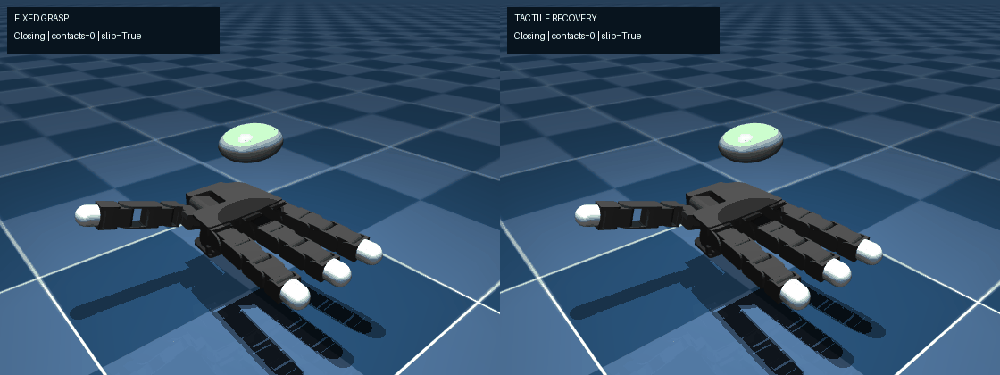
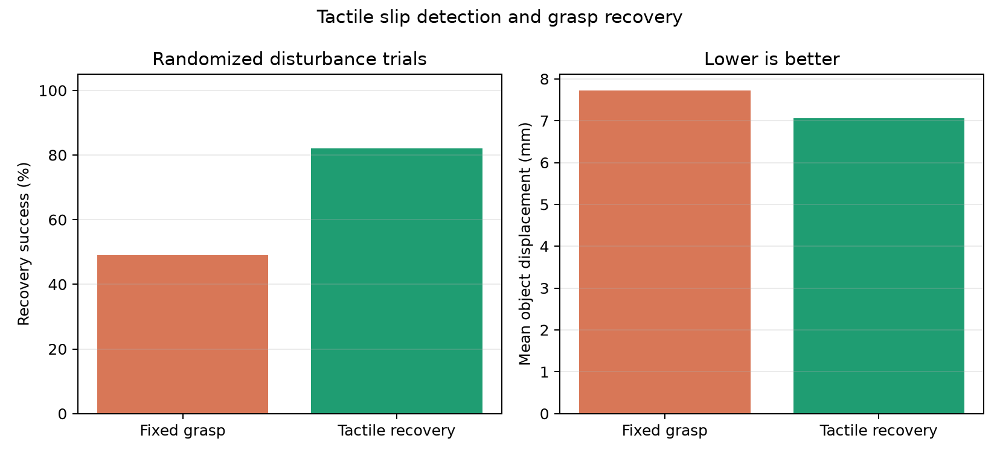
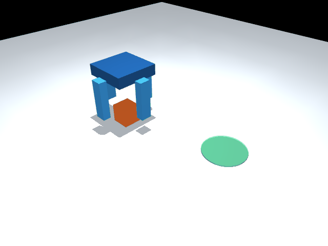
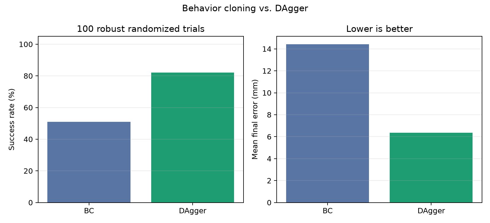
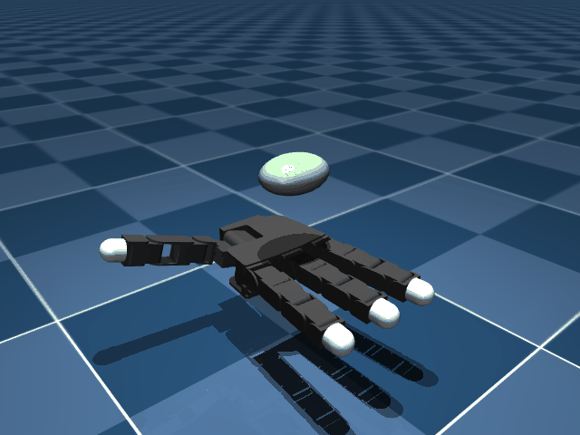

# DexRecover: Tactile-Aware Dexterous Hand Learning

An executable MuJoCo, PyTorch, and ROS2-ready project for tactile slip detection, disturbance recovery, articulated-hand simulation, manipulation demonstrations, behavior cloning, DAgger, and closed-loop robustness evaluation.

## Standout experiment: tactile grasp recovery

The 16-DOF Allegro Hand is subjected to identical randomized 0.20-0.45 N lateral disturbances. The adaptive controller estimates hand-object contact count, normal force and object speed directly from MuJoCo contact dynamics, detects slip, and applies bounded additional closure.

- Fixed grasp: **49/100 recoveries**
- Tactile recovery: **82/100 recoveries**
- Mean slip-detection duration: **38.38 to 18.54 control steps**
- Success requires at least two final hand-object contacts and less than 10 mm displacement.





## Current milestone

The reference task uses a Cartesian palm with four independently actuated contact fingers to grasp a cube, lift it, transport it to a randomized target, lower it, and release it. A deterministic expert generates demonstrations. A compact PyTorch policy learns the mapping from robot/object state and task phase to actuator commands. Evaluation reports task success, final position error, inference latency, and command-safety events.

The reference run achieved 50/50 successes on unseen randomized trials using a 10 mm success radius, 2.21 mm mean final error, and 0.203 ms mean CPU inference latency. See `RESULTS.md` for the evidence boundary and `docs/LIMITATIONS.md` for open work.



## Advanced milestone

- Integrated the official BSD-licensed **MuJoCo Menagerie Wonik Allegro Hand V3** with 16 independently actuated joints.
- Completed 100/100 randomized articulated power-grasp closure trials with 0.0108 rad mean joint RMSE and two maintained hand-object contacts.
- Added domain randomization for object position, mass, friction and joint initialization.
- Evaluated learned transport with 2.5x pose randomization, observation noise, mass/friction changes and a two-step action delay.
- Improved robust success from **51% behavior cloning to 82% DAgger**, while reducing mean final error from **14.43 mm to 6.35 mm**.
- Preserved a rejected third-round checkpoint result as an ablation: success fell to 73%, demonstrating why closed-loop validation controls model selection.





## Run

```bash
python -m venv .venv
source .venv/bin/activate  # Windows: .venv\Scripts\activate
python -m pip install -e ".[dev]"
python scripts/run_pipeline.py
python scripts/run_dagger.py
python scripts/run_articulated_benchmark.py
python scripts/run_tactile_recovery.py
python scripts/render_tactile_comparison.py
python scripts/render_rollout.py
pytest
```

For manual data collection, run `python scripts/teleoperate.py`. The terminal controls palm XYZ and four-finger closure and saves a synchronized observation/action demonstration. Optional ROS2 wrappers and topic contracts are documented in `docs/ROS2_INTERFACES.md`.

## Architecture

```text
expert/teleoperator -> safety monitor -> MuJoCo hand -> demonstration dataset
                                                    -> PyTorch training
                                                    -> closed-loop evaluation
                                                    -> metrics and plots
```

## Engineering evidence

- MuJoCo contact dynamics and fixed-rate control
- Official 16-DOF Allegro Hand V3 model and preserved third-party license
- Randomized object and target initialization
- Versioned, compressed demonstration dataset
- Train/validation split by episode to prevent trajectory leakage
- Episode-level train/validation separation and normalized policy features
- Non-finite, stale, shape, and joint-limit command protection
- Keyboard teleoperation recorder and ROS2 simulation/policy nodes
- DAgger dataset aggregation and BC-versus-DAgger robustness evaluation
- Contact-force tactile estimation, slip detection and bounded grasp recovery
- Automated tests and Linux CI
- Machine-readable JSON metrics and publication-ready plots

## Roadmap

1. Gamepad support and synchronized video recording
2. Learned closed-loop object manipulation directly on the Allegro model
3. RGB/depth perception and object-pose estimation
4. Tactile sensing and sim-to-real calibration
