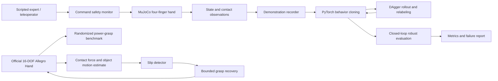

# Architecture

The executable reference uses a compact MuJoCo hand with Cartesian palm motion and four independently actuated fingers. The small model keeps the entire demonstration-to-policy loop reproducible on a CPU. Optional ROS2 simulator and inference nodes wrap the same observation, command, reset and diagnostics interfaces.
